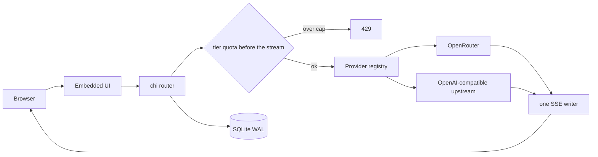
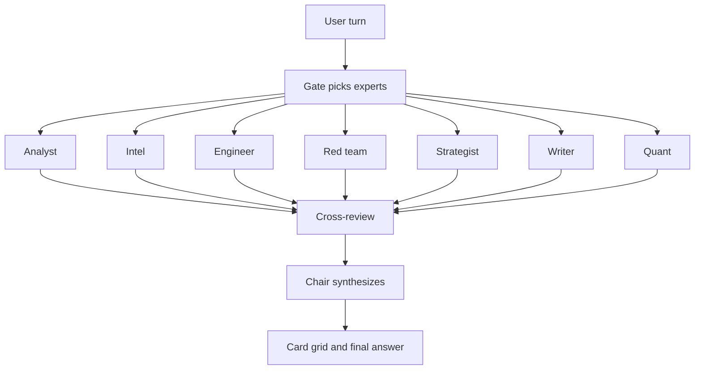
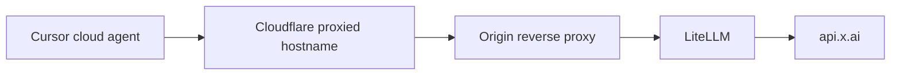

# 系統架構與用量

正式環境在跑的系統。原始碼能公開的已經另外匯出。這一頁只放架構、流程和帳單數字。沒有原點 IP、沒有金鑰、沒有管理路徑、沒有私人聊天紀錄。

# System Architecture and Benchmarks

Systems I run in production. Where the source can be public, it is in a separate export. This page is the architecture, the flows, and the bill. No origin addresses, no credentials, no admin paths, no private chat logs.

用量來自 xAI 主控台匯出，區間 **2026-09-28 至 2026-10-30**。數字沒有再四捨五入成口號。

The usage figures are read off an xAI console export for **28 Sep 2026 – 30 Oct 2026**. They are not rounded into a slogan.

| 指標 Metric | 數值 Value | 怎麼讀 How to read it |
|---|---|---|
| Tokens | 16,840,153,545 | 主控台 Tokens 卡。Console Tokens card. |
| Requests | 1,551,866 | 主控台 Requests 卡。Console Requests card. |
| 快取提示詞 Cached prompt tokens | 13.8B / 15.6B | 13.8 / (13.8 + 1.8) = **88.5%** |
| 文字花費 Text spend | $19,067.25 / $24,142.87 | 文字是大頭，其餘是圖像與影片。Text is the bulk. Image and video are the rest. |

打碼後的主控台截圖在 [GitHub 首頁](https://github.com/web3-ai-game)。

The redacted console crop is on the [GitHub profile](https://github.com/web3-ai-game).

---

## 1. 多模型聊天閘道

一個帳號，三十二個模型，七家廠商：xAI、Anthropic、OpenAI、Google、DeepSeek、MiniMax、Moonshot。開放註冊。每日免費額度按檔位給，Pro 更高。管理員可以對單一使用者設定美元上限。

One account, 32 models, 7 vendors: xAI, Anthropic, OpenAI, Google, DeepSeek, MiniMax, Moonshot. Open registration. Daily free quota by model tier, with a higher Pro tier. An admin can set a USD cap on one user.

交付物是單一 Go 二進位。介面是原生 HTML、CSS、JS，用 `go:embed` 打進去。部署是一個檔案加一個 SQLite。認證是 bcrypt 和 httpOnly cookie。

Shipped as a single Go binary. The UI is plain HTML, CSS, and JS, embedded with `go:embed`. A deploy is one file plus a SQLite database. Auth is bcrypt and an httpOnly cookie.

值得留下的設計：

- 新廠商是註冊表的一列。兩條上游共用同一套 SSE。
- 額度檔位是 `cheap`、`standard`、`premium`、`pro`，紐約時間午夜重置。
- 助手在建立當下把系統提示詞快照進會話。之後修改不會改寫舊紀錄。
- 管理後台管使用者、配額、供應商金鑰和用量。金鑰在執行時注入，不進 git。

Design choices worth keeping:

- A new vendor is a registry row. Both upstreams share one SSE implementation.
- Quota buckets are `cheap`, `standard`, `premium`, and `pro`. They reset at midnight America/New_York.
- Assistants snapshot the system prompt onto the session at creation. Later edits do not rewrite history.
- The admin panel covers users, quotas, provider keys, and usage. Keys are injected at runtime and are not in git.

公開匯出：[multi-llm-gateway](https://github.com/web3-ai-game/multi-llm-gateway)。部署腳本和主機位址不在那個庫裡。

Public export: [multi-llm-gateway](https://github.com/web3-ai-game/multi-llm-gateway). Deploy scripts and the host address are not in that repo.

## 2. 自架 Grok 客戶端

用自己的 xAI 金鑰跑的 Grok 形狀客戶端。手機和 Mac 以 Chrome PWA 安裝。產品域名：[oece-x.com](https://oece-x.com)。這個域名在 Cloudflare 代理後面。

A Grok-shaped client on my own xAI key, installed as a Chrome PWA on phone and Mac. Product host: [oece-x.com](https://oece-x.com). That hostname is proxied by Cloudflare.

同一個輸入框後面有兩條 Heavy：

Two Heavy paths sit behind the same chat box:

| 引擎 Engine | 使用者看得到什麼 What the user sees |
|---|---|
| 官方多智能體直通 Official multi-agent passthrough | 只有議長輸出。議會是黑盒。Leader output only. The council is a black box. |
| 自研專家議會 In-house council | 每位專家的推理和回答，以卡片矩陣即時顯示。Every expert's reasoning and answer, live, as a card grid. |

八個席位：分析師、情報官、工程師、紅隊、策略家、表達者、量化員、議長。門控不必每次叫醒全部。

Eight seats: analyst, intel, engineer, red team, strategist, writer, quant, chair. The gate does not have to wake all eight.

同一個客戶端還有 Auto、Fast、Expert、Heavy、網頁搜尋、推理摘要、圖像與影片、專案、自訂代理、跨會話記憶、排程、引用和語音。花費從每次回應的 cost tick 入帳，再按日、模型和使用者切開。金鑰只在伺服器的環境檔。

The same client also has Auto, Fast, Expert, Heavy, web search, a reasoning summary, image and video, projects, custom agents, cross-session memory, scheduled tasks, citations, and voice. Spend is booked from the cost tick on each response, then sliced by day, model, and user. The key lives only in the server environment file.

公開匯出：[grok-council](https://github.com/web3-ai-game/grok-council)。

Public export: [grok-council](https://github.com/web3-ai-game/grok-council).

## 3. Cursor 到 xAI 的閘道

Cursor 的雲端代理不接受私網位址。所以閘道是一個公開的 OpenAI 相容入口，真正的 xAI 金鑰只在原點。

Cursor's cloud agent will not call a private-network base URL. The gateway is a public OpenAI-compatible front. The real xAI key stays on the origin.

兩條命名規則是正式環境撞出來的：

Two naming rules came out of production:

- 別名不用 Cursor 內建的 `grok-4.x`。否則請求被 Cursor 自己吃掉。Aliases do not use Cursor's built-in `grok-4.x` names, or Cursor keeps the request.
- 上下文長度寫在別名上。等到上游拒絕才壓縮，已經太晚。Context length is set on the alias. Waiting until the upstream rejects the prompt is too late to compress.

公開主機有代理。這一頁不寫原點位址、連接埠或 nginx location。

The public hostname is proxied. This page does not publish origin addresses, ports, or nginx locations.

另一個我在跑的用量閘道是 [oece-depin.com](https://oece-depin.com)。同樣只寫橙雲域名，不寫管理路徑，不寫原點。

A separate usage gateway I operate is [oece-depin.com](https://oece-depin.com). Same rule: orange-cloud hostname only, no admin URL, no origin.

公開匯出：[cursor-xai-gateway](https://github.com/web3-ai-game/cursor-xai-gateway)。

Public export: [cursor-xai-gateway](https://github.com/web3-ai-game/cursor-xai-gateway).

## 4. 私人口譯機器人

兩人群組用的 Telegram 口譯。回覆掛在原訊息下面。它不回答問題，不做摘要，不轉進私訊。

A Telegram interpreter for a two-person group. It replies under the original message. It does not answer questions, summarize, or forward into a private chat.

- 中文出去是越南文。越南文和英文回來是簡體中文，一句一句。Chinese goes out as Vietnamese. Vietnamese and English come back as simplified Chinese, one sentence at a time.
- 最近 12 句用來消解代詞、補回被省略的主語。它們不會被抄進譯文。The last 12 turns disambiguate pronouns and restore a dropped subject. They are not copied into the translation.
- 來源語言裡的口語錯字先正規化，再翻譯。Informal typos in the source language are normalized before translation.
- 短句用不思考模型。遇到 401、429 或逾時，先換備用金鑰，再換不思考的降級模型。草稿如果仍是殘句，就保持沉默。Short lines use a non-reasoning model. On 401, 429, or timeout, the bot walks a backup key, then a fallback non-reasoning model. A fragment stays silent.
- 日誌只記失敗類型和字數，不記原文。Logs store the failure class and the character count, not the source text.

程式、詞彙表和聊天匯出保持私有。

The code, the glossary, and the chat exports stay private.

---

## 公開程式

上面三個系統都有不含部署腳本、原點位址和金鑰的匯出。私有原庫沒有改可見性。

The three systems above have exports without deploy scripts, origin addresses, or secrets. The private originals were not made public.

| 庫 Repo | 內容 What it is |
|---|---|
| [multi-llm-gateway](https://github.com/web3-ai-game/multi-llm-gateway) | Go 閘道：註冊表、共用 SSE、檔位配額、管理後台。Provider registry, shared SSE, tiered quotas, admin panel. |
| [grok-council](https://github.com/web3-ai-game/grok-council) | 客戶端：門控、平行作答、卡片矩陣、SSE。Gate, fan-out, card grid, SSE. |
| [cursor-xai-gateway](https://github.com/web3-ai-game/cursor-xai-gateway) | LiteLLM 別名和用量日誌。沒有原點設定。Aliases and the usage logger. No origin config. |
| [vps-blue-panel](https://github.com/web3-ai-game/vps-blue-panel) | 單檔藍隊面板。評分、SSH 自動還原、本地蜜罐。Scored hardening, SSH auto-rollback, local honeypot. |
| [chain-query-proxy](https://github.com/web3-ai-game/chain-query-proxy) | 標準庫 Go 查詢代理。白名單、限速、快取。Stdlib lookup proxy. Allowlist, rate limit, cache. |

接案請寄 one@oece-x.com。寫語言、期限，以及要上線還是只交原始碼。

For contract work, write to one@oece-x.com. Say the language, the deadline, and whether you need it deployed or only the source.
