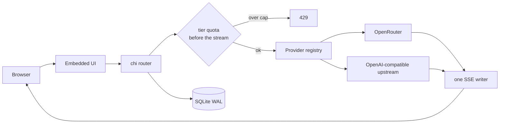
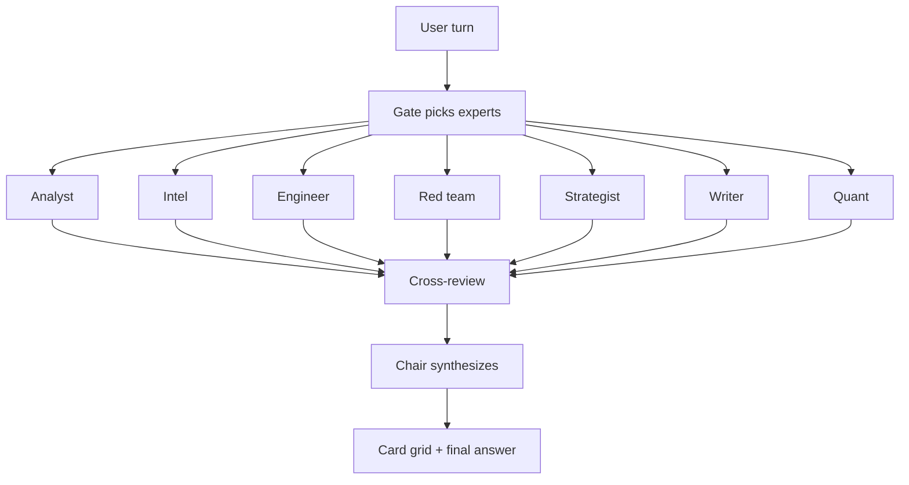
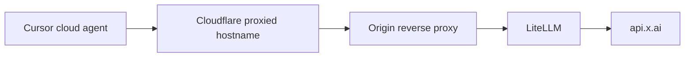

# System Architecture & Benchmarks

Public architecture notes for systems I run in production. Source stays private. Nothing below includes origin IPs, credentials, admin paths, or private chat logs.

Numbers in the usage section are read off an xAI console export for **28 Sep 2026 – 30 Oct 2026**. I am not rounding them into a marketing claim.

| Metric | Value | How to read it |
|---|---|---|
| Tokens | 16,840,153,545 | Console "Tokens" card |
| Requests | 1,551,866 | Console "Requests" card |
| Cached prompt tokens | 13.8B of 15.6B prompt tokens | Cached 13.8B / (cached 13.8B + uncached prompt 1.8B) = **88.5%** |
| Text spend | $19,067.25 of $24,142.87 | Text is the bulk; image & video is the rest |

The redacted console crop is on my [GitHub profile](https://github.com/web3-ai-game).

---

## 1. Multi-model chat gateway

One account, 32 models, 7 vendors: xAI, Anthropic, OpenAI, Google, DeepSeek, MiniMax, Moonshot. Open registration. Daily free quota by model tier, with a higher Pro tier. An admin can override one user with a USD cap.

Shipped as a single Go binary. The UI is plain HTML, CSS, and JS embedded with `go:embed`, so a deploy is one file plus a SQLite database. Auth is bcrypt and an httpOnly cookie.

Design choices worth keeping:

- A new vendor is a registry row. Both upstreams share one SSE implementation.
- Quota buckets are `cheap` / `standard` / `premium` / `pro`, and they reset at midnight America/New_York.
- Assistants snapshot the system prompt onto the session at creation, so later edits do not rewrite history.
- The admin panel covers users, quotas, provider keys, and usage. Keys are injected at runtime and are not in git.

Status: core chat, quotas, assistants, and the admin panel are in production. The repo is private.

## 2. Self-hosted Grok client

A Grok-shaped client on my own xAI key, installed as a Chrome PWA on phone and Mac. Product host: [oece-x.com](https://oece-x.com).

Two Heavy paths sit behind the same chat box:

| Engine | What the user sees |
|---|---|
| Official multi-agent passthrough | Leader output only. The council is a black box. |
| In-house MoE council | Every expert's reasoning and answer, live, as a card grid. |

Eight seats: analyst, intel, engineer, red team, strategist, writer, quant, chair. The gate does not have to wake all eight.

Also in the client, because a chat box without them is not the product I was copying: Auto / Fast / Expert / Heavy, web search, reasoning summary, image and video, projects, custom agents, cross-session memory, scheduled tasks, citations, and voice. Spend is booked from the cost tick on each response, then sliced by day, model, and user.

The key lives only in the server environment file.

## 3. Cursor to xAI gateway

Cursor's cloud agent will not call a private-network base URL. The gateway is therefore a public OpenAI-compatible front, with the real xAI key only on the origin.

Two naming rules that came out of production, not from a diagram:

- Aliases do not use Cursor's built-in `grok-4.x` names, or Cursor routes the call to its own provider.
- Context length is set on the alias. Waiting until the upstream rejects the prompt is too late to compress.

The public hostname is proxied. This page does not publish origin addresses, ports, or nginx locations.

A separate usage gateway I operate for other models is [oece-depin.com](https://oece-depin.com). Same rule: orange-cloud hostname only, no admin URL, no origin.

## 4. Private interpreter bot

A Telegram interpreter for a two-person group. It replies under the original message. It does not answer, summarize, or forward into a private chat.

- Chinese goes out as Vietnamese. Vietnamese and English come back as simplified Chinese, one sentence at a time.
- The last 12 turns disambiguate pronouns and restore a dropped subject. They are not copied into the translation.
- Informal typos in the source language are normalized before translation.
- Short lines use a non-reasoning model. On 401, 429, or timeout the bot walks a backup key, then a fallback non-reasoning model. If the draft is still only a fragment, it stays silent.
- Logs store the failure class and the character count, not the source text.

The code, the glossary, and the chat exports stay private.

---

## Public code

The three systems above are exported without deploy scripts, origin addresses, or secrets. The private repos are unchanged.

| Repo | What it is |
|---|---|
| [multi-llm-gateway](https://github.com/web3-ai-game/multi-llm-gateway) | The Go gateway: provider registry, shared SSE, tiered quotas, admin panel |
| [grok-council](https://github.com/web3-ai-game/grok-council) | The client: council gate, fan-out, card grid, SSE |
| [cursor-xai-gateway](https://github.com/web3-ai-game/cursor-xai-gateway) | LiteLLM aliases and the usage logger. No origin config |

Also public: [vps-blue-panel](https://github.com/web3-ai-game/vps-blue-panel), a scored hardening panel with SSH auto-rollback, and [chain-query-proxy](https://github.com/web3-ai-game/chain-query-proxy), a stdlib Go lookup proxy.
